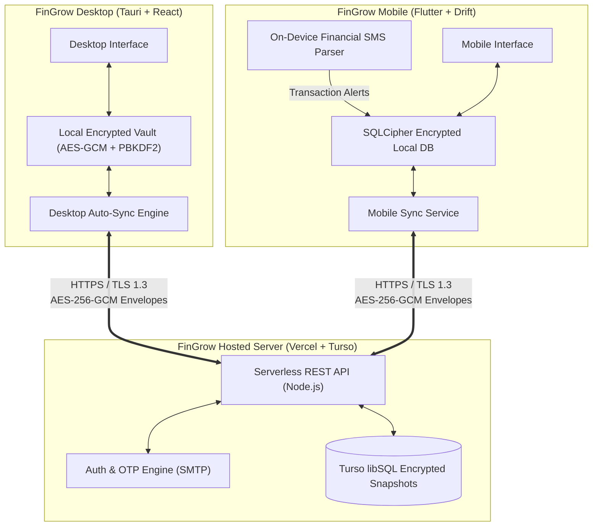

# FinGrow: Architecture, Zero-Knowledge Sync & Cross-Platform Connection Guide

> **Version**: 2.0.0 • **Last Updated**: November 2026  
> **Ecosystem**: Cloud Backend (Vercel Serverless + Turso libSQL) • Desktop Client (Tauri v2 + Next.js 16 + React 19) • Mobile Client (Flutter 3.x + Drift + SQLCipher)

---

## 1. Executive Summary & Architecture Overview

FinGrow is an offline-first, zero-knowledge private financial workspace designed to manage personal and household wealth, multi-currency accounts, payment cards, budgets, split expenses, and sensitive documents.

Unlike traditional cloud-native banking applications that store unencrypted financial records on corporate servers, FinGrow operates on a **Zero-Knowledge Architecture (ZKA)**:
1. **Primary Data Sovereignity**: The user's device is the primary source of truth. Data is stored in encrypted local databases on the desktop and mobile phone.
2. **Zero-Knowledge Cloud**: The server database (Turso/libSQL) acts strictly as a blinded synchronization hub. It receives and stores end-to-end encrypted snapshot blobs (`AES-256-GCM`). The backend server **cannot decrypt, inspect, or query** financial balances, transactions, account numbers, or document attachments.
3. **Deterministic Key Derivation**: Encryption keys are derived entirely on the client from the user's master password combined with profile-specific cryptographic salts (`sync_salt`).



---

## 2. Zero-Knowledge Cryptographic Specification

### 2.1 Key Derivation Function (KDF)
FinGrow uses client-side key derivation complying with OWASP 2024 standards:
* **Algorithm**: PBKDF2-HMAC-SHA256
* **Iterations**: `600,000` rounds
* **Local Vault Salt**: 16 cryptographically secure random bytes generated via `crypto.getRandomValues()` on first initialization.
* **Sync Encryption Salt**: Each created `profile` receives a dedicated 16-byte base64-encoded `sync_salt`. This salt is stored on the server to allow multi-device derivation:
  $$\text{SyncKey} = \text{PBKDF2}(\text{password}, \text{sync\_salt}, 600000, 32)$$

### 2.2 Symmetric Payload Encryption
* **Cipher**: AES-GCM (Galois/Counter Mode) with 256-bit keys.
* **Initialization Vector (IV)**: 96-bit (12 bytes) non-repeating cryptographic nonce generated uniquely for every snapshot encryption.
* **Authentication Tag**: 128-bit authentication tag appended to the ciphertext ensuring ciphertext integrity and authenticity.
* **Envelope Schema**:
  ```json
  {
    "formatVersion": 1,
    "iv": "u9p...base64 (12 bytes)",
    "ciphertext": "8xF...base64 (variable length with 16-byte GCM tag)"
  }
  ```

---

## 3. User Registration, Authentication & Identity Flow

### 3.1 Strict Online Onboarding Mechanism
Per system security requirements, new account creation requires active internet connectivity and two-factor email verification:
1. **User Request**: User provides `fullName`, `email`, and `password` ($\ge 8$ chars) on the registration screen.
2. **Email Verification Trigger**: Client submits `POST /v1/auth/otp/request`.
   - Backend creates an `otp_challenges` record containing an HMAC-SHA256 hash of the 6-digit verification code.
   - The challenge is rate-limited (max 3 requests per 15 minutes per email) and expires in 10 minutes.
   - An email with the 6-digit code is dispatched via authenticated SMTP (Nodemailer with TLS 1.2+).
3. **Minimalist OTP Verification**:
   - The client renders a responsive 6-digit tile interface with smooth tactile typing animations.
   - Upon entering the 6th digit, the code is automatically submitted to `POST /v1/auth/otp/verify`.
   - The backend validates the code using constant-time equality (`crypto.timingSafeEqual`).
   - If incorrect, the tile row shakes horizontally and increments an attempt counter (max 5 attempts before challenge invalidation).
   - If correct, the tile row displays an animated SVG checkmark (✓) with the label **"Verified"**.

### 3.2 Dual Database Storage (Server & Local)
When registration succeeds:
1. **Server Storage (`Turso libSQL`)**:
   - Stores `users` record: `id` (UUIDv4), `email`, `full_name`, and `password_hash` (`scrypt` with 16-byte random salt, format `scrypt$salt$hash`).
   - Stores default `profiles` record: `id`, `user_id`, `name`, `currency` (INR), and `sync_salt`.
   - Issues a 90-day cryptographically secure Bearer token (`randomBytes(32).toString('base64url')`), storing only its HMAC-SHA256 digest in `access_tokens`.
2. **Local Storage (Desktop & Mobile)**:
   - Desktop derives the local encryption key and creates the local vault in IndexedDB / `%LOCALAPPDATA%\com.fingrow.desktop`.
   - Saves cloud sync credentials (`accessToken`, `userId`, `profileId`, `syncSalt`, `password`).

---

## 4. Legal Compliance, DPDP Act 2023 & Consent Protocol

### 4.1 Legal Regulatory Context
FinGrow strictly complies with:
* **Indian Digital Personal Data Protection (DPDP) Act, 2023 (Sections 6 & 7)**
* **Reserve Bank of India (RBI) Guidelines on Digital Lending & Account Aggregation**
* **EU General Data Protection Regulation (GDPR, Articles 6 & 7)**
* **Google Play / Apple App Store Financial Permissions Disclosure Policies**

### 4.2 Mandatory Pre-Entry Consent Gateway
Immediately after OTP verification, the user **cannot pass into the application** without explicitly reviewing and consenting to the Legal Terms and Privacy Consents:

```
+----------------------------------------------------------------+
|                 [Shield Icon]                                  |
|          Terms of Service & Privacy Consents                   |
|                                                                |
|  [Legal Charter] Zero-Knowledge & Local-First Guarantee        |
|  FinGrow stores financial records locally on this device...    |
|                                                                |
|  [x] Financial Transaction SMS Processing (Local On-Device)    |
|      Only parses bank/card debits and credits locally.         |
|      Personal SMS, chats, and OTPs are NEVER read or stored.   |
|                                                                |
|  [x] Encrypted Cloud Sync & Server Storage (Required)          |
|      Stores E2EE backup blobs in server DB (Turso). Zero-      |
|      knowledge: server operators cannot read financial data.   |
|                                                                |
|  [x] Local Encrypted Vault & Device Storage (Required)         |
|      Initializes AES-GCM local DB with PBKDF2 key derivation.  |
|                                                                |
|  [x] Agreement to Terms of Service & Privacy Policy (Required) |
|      Confirms age (18+) and acceptance of data policies.       |
|                                                                |
|  [ I Accept & Enter Workspace -> ]     [ Decline & Exit ]      |
+----------------------------------------------------------------+
```

### 4.3 Legal Enforcement & Decline Behavior
* **If Accepted**:
  - Timestamp, version string (`2026.11-v1`), and individual consent flags are saved in local storage.
  - The client dispatches an authenticated `POST /v1/auth/consent` request to the backend. The server records `consented_at = Date.now()`, `consent_version`, and `consents_json` in the user's permanent database record for regulatory audit compliance.
  - The workspace is unlocked.
* **If Declined**:
  - The application wipes all in-memory credentials, clears local vault session keys, and navigates back to the sign-in screen.
  - An explicit notification is displayed:  
    *"Terms of Service and required privacy consents were declined. FinGrow cannot grant access without essential storage and privacy consents."*
  - **Zero access is permitted.**

### 4.4 Transactional SMS Privacy Charter
On mobile devices (Android), FinGrow parses incoming financial notifications and SMS messages using local regex matching (`notification_parser.dart`).
* **Strict Whitelist**: Only matches sender handles originating from recognized financial institutions (e.g., `HDFCBK`, `SBIINB`, `ICICIB`, `AXISBK`).
* **Zero Cloud Transmission of Raw Messages**: Raw message strings **never leave device RAM**. Only the extracted structured transaction (amount, merchant name, timestamp, and account suffix) is committed to the local database.
* **Absolute Exclusion**: Personal text messages, conversational SMS, and multi-factor authentication OTPs are completely ignored and discarded.

---

## 5. Cross-Platform Data Sync Protocol

FinGrow achieves seamless multi-device synchronization across Desktop and Mobile using optimistic snapshot revision tracking:

### 5.1 Dataset Schema Representation
The client serializes its local SQLite / IndexedDB state into a standardized JSON dataset containing 14 normalized collections:
```json
{
  "users": [...],
  "profiles": [...],
  "accounts": [...],
  "cards": [...],
  "transactions": [...],
  "plans": [...],
  "goals": [...],
  "splitGroups": [...],
  "splitExpenses": [...],
  "documents": [...],
  "subscriptions": [...],
  "emis": [...],
  "preferences": {...},
  "notificationCandidates": [...]
}
```

### 5.2 Optimistic Concurrency Control (OCC)
1. **Pull Step**: Client requests `GET /v1/profiles/:profileId/snapshot`.
   - Server returns `{ revision: N, envelope: { iv, ciphertext }, updatedAt }`.
   - If `revision > localBaseline`, client decrypts `envelope.ciphertext` using its `SyncKey` and merges remote records into its local database.
2. **Push Step**: Client encrypts its updated dataset into an AES-256-GCM envelope and issues `PUT /v1/profiles/:profileId/snapshot`:
   ```json
   {
     "expectedRevision": N,
     "envelope": {
       "formatVersion": 1,
       "iv": "...",
       "ciphertext": "..."
     }
   }
   ```
3. **Conflict Resolution**:
   - If another device pushed a snapshot in the interim, the server detects that `currentRevision != expectedRevision` and rejects the push with `HTTP 409 Conflict` returning the latest `revision`.
   - The client pulls the newer remote revision, runs deterministic Last-Write-Wins (LWW) entity reconciliation on conflicting records (matching by `updatedAt` / `createdAt`), and re-attempts the push.

---

## 6. Backend API Specification

| Method | Endpoint | Auth | Purpose & Payload |
|---|---|---|---|
| `GET` | `/health` | None | Service heartbeat, Turso connection check, SMTP status. |
| `POST` | `/v1/auth/otp/request` | None | Requests email verification code: `{ email, fullName, currency, purpose }`. Protected by IP and account rate limiting. |
| `POST` | `/v1/auth/otp/verify` | None | Verifies OTP: `{ challengeId, email, code, password?, fullName? }`. Returns session & token. Max 5 attempts. |
| `POST` | `/v1/auth/login` | None | Password login: `{ email, password }`. Returns session & token. Rate-limited against brute force. |
| `POST` | `/v1/auth/consent` | Bearer | Records regulatory consent under DPDP Act 2023 / GDPR: `{ version, consents: { transactionalSms, encryptedCloudSync, localVault } }`. |
| `POST` | `/v1/auth/consent/withdraw` | Bearer | Revokes cloud sync consent and purges encrypted snapshots from server database. |
| `DELETE` | `/v1/auth/me` | Bearer | DPDP Act 2023 / GDPR Right to Erasure: Permanently erases account, profiles, tokens, and cloud snapshots. |
| `GET` | `/v1/auth/export` | Bearer | DPDP Act 2023 / GDPR Right to Data Portability: Exports personal account metadata, profile list, and consent records. |
| `GET` | `/v1/auth/me` | Bearer | Fetches user identity and profile list for the current token. |
| `POST` | `/v1/auth/logout` | Bearer | Revokes the current access token. |
| `GET` | `/v1/profiles/:id/snapshot` | Bearer | Fetches latest encrypted snapshot envelope and revision. |
| `PUT` | `/v1/profiles/:id/snapshot` | Bearer | Uploads new encrypted snapshot envelope with OCC revision check. |

---

## 7. Hardened Security Features Implemented

1. **Password Hashing**: Salted `scrypt` (`scrypt$salt$hash`) with 16-byte random salt, OWASP parameters (`N=16384, r=8, p=1`), and timing-safe equality checks (`timingSafeEqual`) preventing rainbow-table and timing attacks. Password length bounded to 8-128 characters.
2. **Sliding-Window Rate Limiting**: In-memory rate limiting tracking client IPs and email accounts:
   - OTP Requests: 10 requests / 15 min per IP, 5 requests / 15 min per email.
   - Password Logins: 20 requests / 15 min per IP, 10 failed attempts / 15 min per email.
   - OTP Verification: 25 requests / 15 min per IP, max 5 failed attempts per challenge.
3. **Legal Compliance & User Sovereignity (DPDP Act 2023 & GDPR)**:
   - **Permission & Consent Gateway**: Mandatory blocking consent dialog before any workspace record can be accessed or stored.
   - **Right to Erasure (`DELETE /v1/auth/me`)**: Complete atomic deletion of user accounts, profiles, tokens, challenges, and cloud snapshots.
   - **Right to Withdraw Consent (`POST /v1/auth/consent/withdraw`)**: Immediate revocation of cloud sync consent and purging of server snapshots.
   - **Right to Data Portability (`GET /v1/auth/export` & Desktop Export)**: One-click export of decrypted personal financial ledgers.
4. **Access Token Hardening**: High-entropy 256-bit URL-safe tokens stored in database only as HMAC-SHA256 digests.
5. **HTTP Security Headers**:
   - `Strict-Transport-Security: max-age=31536000; includeSubDomains; preload`
   - `X-Content-Type-Options: nosniff`
   - `X-Frame-Options: DENY`
   - `Cache-Control: no-store, no-cache, must-revalidate`
   - `Referrer-Policy: no-referrer`
   - `Permissions-Policy: camera=(), microphone=(), geolocation=(), payment=()`
   - `X-Permitted-Cross-Domain-Policies: none`
   - `Content-Security-Policy: default-src 'none'; frame-ancestors 'none'`
6. **CORS Restrictions**: Explicit origin whitelist with regular expressions allowing only verified production domains and secure desktop/mobile protocols (`tauri://localhost`, `http://tauri.localhost`). Allowed methods: `GET, POST, PUT, DELETE, OPTIONS`.
7. **SQL Injection Immunity**: 100% of SQL executions utilize parameterized bindings (`?`).
8. **Payload Guarding**: Strict streaming payload limit (4 MB on Vercel) preventing denial-of-service memory exhaustion.
7. **Isolated Vault Decryption**: Master passwords and derived keys are retained only in volatile closure memory and purged immediately upon vault lock or application close.

---

## 8. Deployment & Environment Configuration

### Backend (`.env`)
```env
FINGROW_BACKEND_PORT=4317
FINGROW_BACKEND_HOST=127.0.0.1
TURSO_DATABASE_URL=libsql://your-database-name.turso.io
TURSO_AUTH_TOKEN=your-turso-jwt-token
FINGROW_OTP_HASH_SECRET=your-random-32-byte-hex-string
FINGROW_TOKEN_HASH_SECRET=your-random-32-byte-hex-string
SMTP_HOST=smtp.gmail.com
SMTP_PORT=465
SMTP_SECURE=true
SMTP_USER=your-email@gmail.com
SMTP_PASS=your-16-character-app-password
SMTP_FROM=FinGrow Security <your-email@gmail.com>
```

### Desktop (`desktop/`)
```bash
# Build desktop standalone bundle
pnpm --prefix desktop build:desktop

# Run regression test suite (12 financial assessment scenarios + 14 UI tests)
pnpm --prefix desktop test
```

### Mobile (`mobile/`)
```bash
# Run on connected device / emulator with backend URL
flutter run --dart-define=FINGROW_BACKEND_URL=https://fingrow-backend-thrytes.vercel.app
```
